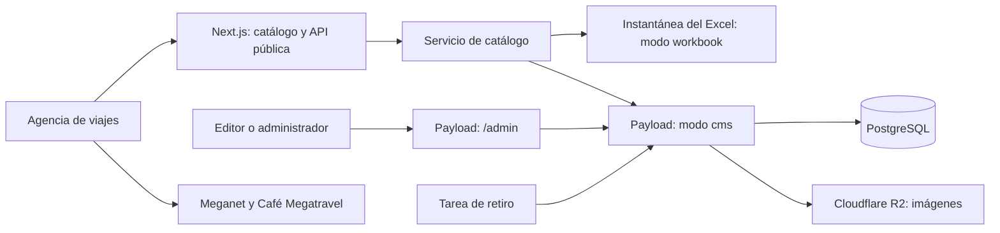

# Arquitectura y estructura del proyecto

## Qué hace la aplicación

Una misma aplicación Next.js contiene el catálogo público, sus endpoints y el panel de Payload. El visitante encuentra una salida y continúa hacia Meganet o Café Megatravel mediante los enlaces originales. La aplicación no confirma reservas ni cobra pagos.

Payload aporta autenticación, formularios, tablas, relaciones, versiones y API administrativa. Las reglas propias de Megatravel deciden si una salida puede publicarse, cuándo se retira y qué información puede recibir el público.



SQLite es una alternativa de desarrollo. La configuración de producción utiliza PostgreSQL. El acceso a R2 se realiza mediante su API compatible con S3.

## Árbol de referencia

```text
bloqueosweb/
├── docs/                         Documentación técnica y operativa
├── migration/                    Datos normalizados y reportes del Excel
├── public/                       Archivos públicos servidos directamente
│   ├── icon.svg                  Icono del sitio
│   └── flyers/                   Copias locales, si se ejecuta la descarga
├── scripts/                      Comandos de importación, operación y comprobación
├── src/
│   ├── app/
│   │   ├── (catalog)/            Catálogo, estilos, preview y endpoints propios
│   │   │   ├── api/
│   │   │   │   ├── public/catalog/route.ts
│   │   │   │   ├── admin-tools/[action]/route.ts
│   │   │   │   ├── cron/retire/route.ts
│   │   │   │   └── health/route.ts
│   │   │   ├── preview/[id]/page.tsx
│   │   │   ├── page.tsx
│   │   │   ├── layout.tsx
│   │   │   ├── globals.css
│   │   │   ├── loading.tsx
│   │   │   ├── error.tsx
│   │   │   └── not-found.tsx
│   │   └── (payload)/            Integración del panel y API de Payload
│   │       ├── admin/[[...segments]]/page.tsx
│   │       ├── admin/importMap.js
│   │       ├── api/[...slug]/route.ts
│   │       ├── layout.tsx
│   │       └── custom.css
│   ├── collections/             Modelo de contenido y usuarios de Payload
│   ├── components/              Componentes de interfaz reutilizables
│   │   ├── admin/               Extensiones visuales del CMS
│   │   └── ui/                  Botones y diálogos base
│   ├── data/catalog.json        Instantánea preparada para revisar el catálogo
│   ├── lib/                     Tipos, filtros y reglas sin acceso a la base
│   ├── migrations/              Migraciones del esquema de PostgreSQL
│   ├── server/                  Acceso a datos, permisos, importación e historial
│   ├── payload.config.ts        Configuración central del CMS
│   └── payload-types.ts         Tipos generados por Payload
├── tests/                        Pruebas del dominio y del servicio de importación
├── .env.example                  Plantilla de variables sin claves reales
├── .gitignore                    Exclusiones de Git
├── .gitattributes                Normalización de archivos entre sistemas
├── .nvmrc                        Versión de Node de referencia
├── Dockerfile                    Construcción y ejecución del contenedor
├── .dockerignore                 Exclusiones del contexto Docker
├── compose.yaml                  PostgreSQL para desarrollo local
├── railway.toml                  Configuración de despliegue de Railway
├── next.config.mjs               Integración Next.js/Payload y salida standalone
├── package.json                  Dependencias y comandos
├── package-lock.json             Versiones resueltas de dependencias
├── tsconfig.json                 Configuración TypeScript y alias
├── postcss.config.mjs            Procesamiento de Tailwind
├── components.json               Convenciones de componentes shadcn/ui
└── README.md                     Entrada al proyecto
```

Las carpetas generadas pueden aparecer después de ejecutar comandos. El árbol no exige que `public/flyers/` exista antes de descargar las imágenes.

## `src/app`: páginas y rutas HTTP

Next.js usa esta carpeta para decidir qué responder a cada URL. Los nombres entre paréntesis son grupos organizativos y **no forman parte de la URL**. Por ejemplo, `(catalog)/preview/[id]` produce `/preview/123`, no `/(catalog)/preview/123`.

`[id]` representa un segmento variable. `[...slug]` recibe varios segmentos. `[[...segments]]` es opcional y permite que el panel atienda tanto `/admin` como sus pantallas internas.

### Grupo `(catalog)`

| Archivo | Responsabilidad | Cambio habitual |
| --- | --- | --- |
| `page.tsx` | Carga el catálogo en el servidor y pasa la consulta de la URL al componente principal | Cambiar cómo se inicia la página o se proporcionan datos |
| `layout.tsx` | Define idioma, metadatos, icono y carga opcional de GA4 | Título del navegador, descripción, analítica |
| `globals.css` | Define tipografía, colores, cuadrícula, filtros, tarjetas y comportamiento responsive | Ajustes visuales del catálogo |
| `loading.tsx` | Estado mientras se prepara la página | Texto o presentación de carga |
| `error.tsx` | Mensaje recuperable de error con reintento | Mensaje cuando el catálogo falla |
| `not-found.tsx` | Página no encontrada del grupo | Mensaje y enlace de regreso |
| `preview/[id]/page.tsx` | Preview privado de una salida guardada; exige editor autenticado | Ampliar el preview guardado |
| `api/public/catalog/route.ts` | Respuesta pública con datos comerciales | Contrato HTTP del catálogo |
| `api/admin-tools/[action]/route.ts` | Opciones, CSV, duplicación y copia de imágenes | Herramientas administrativas propias |
| `api/cron/retire/route.ts` | Ejecuta retiros con autenticación de servicio | Integración con el programador externo |
| `api/health/route.ts` | Señal de salud usada por el alojamiento | Comprobación de disponibilidad |

Un archivo `page.tsx` genera una página. Un `route.ts` implementa un endpoint HTTP. Las reglas comerciales se delegan a `lib/` y `server/`, para que no dependan de la presentación.

### Grupo `(payload)`

| Archivo | Responsabilidad |
| --- | --- |
| `layout.tsx` | Monta el panel de Payload y sus funciones de servidor; atiende contenido dinámico |
| `admin/[[...segments]]/page.tsx` | Delega las pantallas del CMS a Payload |
| `api/[...slug]/route.ts` | Delega GET, POST, PATCH, PUT, DELETE y OPTIONS a la API de Payload |
| `admin/importMap.js` | Relaciona rutas de componentes personalizados con sus implementaciones |
| `custom.css` | Estilos exclusivos de las herramientas y previews administrativos |

El mapa de importaciones se regenera con `npm run generate:importmap`. Para añadir un componente administrativo, se registra en la configuración de Payload o de una colección y se regenera el mapa. Editar únicamente el archivo generado no constituye una integración duradera.

## `src/components`: presentación

| Archivo o carpeta | Qué contiene |
| --- | --- |
| `catalog.tsx` | Cabecera, hero, buscador, filtros, resultados, paginación, contacto y pie. También `FilterPanel`, que se reutiliza en escritorio y móvil |
| `package-card.tsx` | Una tarjeta de salida: flyer, ampliación, datos comerciales, reserva, descriptivo y eventos de clic |
| `campaign-banner.tsx` | Banners administrados y carrusel manual; presenta una composición de marca cuando no hay banners |
| `brand.tsx` | Logo enlazado a inicio y representación alternativa si la imagen falla |
| `ui/button.tsx` | Variantes de botón y opción de aplicar su estilo a un enlace |
| `ui/dialog.tsx` | Diálogo con Radix: overlay, cierre, título y descripción accesibles |
| `admin/workspace-tools.tsx` | Accesos de estado, duplicación, creación de fechas, importación/exportación y reintento de imágenes |
| `admin/card-preview.tsx` | Preview dentro del formulario con valores aún no guardados |
| `admin/cutoff-preview.tsx` | Fecha de retiro calculada a partir del formulario antes de guardar |

Los componentes que usan estado, eventos o APIs del navegador tienen comportamiento cliente. Los componentes cliente reciben solo los datos que el servidor decide proporcionarles. El archivo de configuración del CMS y las credenciales no deben importarse en ellos.

## `src/lib`: contratos y reglas reutilizables

| Archivo | Funciones y responsabilidad |
| --- | --- |
| `types.ts` | Contratos `Departure`, `PublicPackage`, `CatalogData`, `CatalogFilters`, `Promotion` y `Banner` |
| `catalog.ts` | `PAGE_SIZE`, normalización, filtros vacíos, parseo/serialización de URL, selección y ordenamiento, proyección pública y formatos de presentación |
| `lifecycle.ts` | Validación de fechas y enlaces; cálculo de retiro; vigencia; validación de publicación y cambios de estado |
| `csv.ts` | Lectura y exportación CSV; normalización de fechas y precios |
| `import-records.ts` | Convierte filas CSV a registros y prepara un plan con aceptados y errores |
| `brand-config.ts` | Logo y contacto por defecto del sitio |
| `analytics.ts` | Tipos y envío de eventos GA4 desde el navegador |
| `utils.ts` | Combinación de clases CSS utilizada por los componentes UI |

`lib/` no es completamente código de servidor: varias funciones se ejecutan también en el navegador. Los cambios aquí pueden afectar al catálogo, la importación y el CMS simultáneamente. `analytics.ts` es específicamente cliente.

## `scripts` y `tests`: herramientas y comprobaciones

| Script | Responsabilidad |
| --- | --- |
| `read-xlsx.mjs` | Lector OOXML del Excel; muestra estructura y valores sin ejecutar fórmulas/macros |
| `prepare-workbook.mjs` | Mapea columnas, conserva procedencia, prepara CSV/JSON y separa borradores/históricos |
| `download-assets.mjs` | Copia las URLs únicas a recursos locales y escribe manifiesto/reporte |
| `import-cms.ts` | Entrada CLI al importador, con administrador atribuido y modo validar/escribir |
| `bootstrap.ts` | Crea la primera cuenta de administrador con valores privados del entorno |
| `retire.ts` | Entrada CLI al servicio de retiro; termina al completar la tarea |
| `start.mjs` | Inicia el servidor standalone y reenvía señales de cierre |
| `backup.mjs` | Ejecuta dump o restauración de prueba con credenciales en variables de entorno |
| `check-source.mjs` | Comprobación sintáctica de fuentes mediante TypeScript |
| `check-domain-types.mjs` | Comprobación de tipos limitada al dominio independiente |
| `verify-cms.ts` | 14 comprobaciones con Payload, SQLite y cargas aisladas bajo `.qa/`; verificadas el 24 de octubre |
| `check-repository.mjs` | Revisa archivos candidatos/preparados para evitar incluir rutas locales y patrones conocidos de claves |
| `prepare-commits.mjs` | Prepara los dos commits iniciales, o describe el plan sin escribir; no gestiona remotos |

En `tests/`, `catalog.test.mjs` cubre filtros/URL/proyección pública; `lifecycle.test.mjs`, fechas y transiciones; `import.test.mjs`, CSV y preparación del Excel; e `import-service.test.mjs`, actualizaciones repetidas con un doble de persistencia. Estas pruebas no reemplazan la verificación del adaptador real de PostgreSQL.

## `src/server`: operaciones del servidor

| Archivo | Responsabilidad |
| --- | --- |
| `payload.ts` | Obtiene la instancia de Payload y comprueba la configuración de acceso al CMS |
| `catalog-service.ts` | Elige entre instantánea y CMS, consulta registros, aplica vigencia y construye la respuesta pública |
| `normalize.ts` | Convierte documentos y relaciones de Payload a los contratos propios; obtiene nombres y URL de medios |
| `access.ts` | Funciones de acceso para administrador/editor y denegación de operaciones |
| `admin-auth.ts` | Autentica las herramientas propias y comprueba el origen de sus escrituras |
| `hooks.ts` | Antes de guardar: identificadores, copia de imagen, corte y validaciones. Después de guardar: historial |
| `import-service.ts` | Importa CSV contra Payload; crea referencias, reutiliza medios, actualiza por clave y produce un reporte por fila |
| `media-import.ts` | Descarga controlada de imágenes, validación de tamaño/formato y creación del medio |
| `retire-service.ts` | Busca salidas publicadas vencidas, vuelve a comprobar su estado y las retira con historial |

`payload.ts` y `catalog-service.ts` declaran `server-only`. Los otros servicios también se usan desde scripts de Node; algunos solo necesitan tipos de Payload en tiempo de compilación. No se deben llevar operaciones de base o descarga al componente visual para evitar la capa de validación y permisos.

## `src/collections` y configuración central

`content.ts` define Salidas, Imágenes, Promociones, Banners, Destinos, Orígenes, Navieras e Historial, además del global Configuración del catálogo. `users.ts` define cuentas, roles y acceso al panel.

`payload.config.ts` reúne estas definiciones, el idioma español, huso horario, adaptador de base, almacenamiento R2, límite de carga, origen permitido y componentes del inicio administrativo. Se cambia aquí cuando se añade una colección o se cambia una integración, no para actualizar la tarifa de una salida.

`payload-types.ts` describe los tipos que Payload genera a partir del esquema. No se mantiene a mano. Si cambia una colección, hay que regenerarlo y revisar si el esquema PostgreSQL necesita una migración.

## `src/data`, `migration` y `src/migrations`

- `src/data/catalog.json`: instantánea preparada. Se usa con `CATALOG_SOURCE=workbook`, se empaqueta con el código y no se actualiza por editar el Excel o el CMS. Su generación explícita actualiza el archivo.
- `migration/`: material de traslado del contenido. Incluye CSV, JSON normalizado, URLs, manifiesto de imágenes y reportes. No es una base de datos en funcionamiento.
- `src/migrations/`: cambios del esquema de la base. Actualmente tiene instrucciones para generar la primera migración; no hay una migración SQL inicial aprobada.

Que `migration/departures.csv` esté en Git no significa que esas filas estén cargadas en PostgreSQL. Son pasos distintos.

## `public` y `media`

Todo lo situado en `public/` puede servirse sin autenticar. `public/icon.svg` responde en `/icon.svg`; un archivo de `public/flyers/` responde en `/flyers/nombre.png`. No se deben colocar allí exportaciones privadas, contraseñas ni copias de base.

`media/` es el almacenamiento local por defecto de Payload cuando no se usa R2. `MEDIA_DIR` permite fijar otra ruta; el Dockerfile utiliza `/app/media` para mantenerla común entre scripts y servidor standalone. Las cargas están excluidas de Git. En producción deben persistir en R2 o en un volumen montado en esa ruta; no depender del disco temporal del contenedor. La opción de volumen sigue pendiente de validación en Railway.

## Docker y archivos raíz

No existe una carpeta `docker/` en este proyecto. Docker se configura con archivos en la raíz:

| Archivo | Qué controla |
| --- | --- |
| `Dockerfile` | Etapa de instalación/build y etapa de ejecución con usuario `node`; copia salida standalone, recursos, scripts y esquema |
| `.dockerignore` | Evita incluir dependencias locales, secretos, Excel, datos de migración y respaldos en el contexto del contenedor |
| `compose.yaml` | Levanta solo PostgreSQL local y su volumen. No inicia toda la aplicación |
| `railway.toml` | Usa Dockerfile, define `/api/health` y la política de reinicio. No crea la base, el bucket ni el cron |
| `next.config.mjs` | Activa `withPayload`, salida standalone y cabeceras HTTP |
| `package.json` | Dependencias directas, requisito de Node y comandos |
| `package-lock.json` | Versiones exactas resueltas; permite reinstalar con `npm ci` |
| `tsconfig.json` | Opciones de TypeScript y alias `@/` y `@payload-config` |
| `next-env.d.ts` | Declaraciones de tipos de Next; archivo de integración generado |
| `postcss.config.mjs` | Activa el procesamiento de Tailwind CSS |
| `components.json` | Preferencias y rutas para componentes shadcn/ui |
| `.env.example` | Lista compartida de variables; los valores reales van fuera de Git |
| `.nvmrc` | Versión de referencia para gestores de Node; no instala ni cambia Node por sí solo |
| `.gitattributes` | Fin de línea LF para texto y tratamiento binario de imágenes |
| `.gitignore` | Archivos locales que Git no debe incorporar |

## Carpetas generadas y Git

| Carpeta | Uso | ¿Se versiona? |
| --- | --- | --- |
| `node_modules/` | Paquetes instalados | No; se reconstruye con `npm ci` |
| `.next/` | Caché y salida de Next | No; se reconstruye al ejecutar desarrollo/build |
| `.qa/` | Herramientas auxiliares y bases aisladas de comprobación | No |
| `.npm-cache/` | Caché local de npm | No |
| `backups/` | Dumps de base de datos | No |
| `.git/` | Historial, índice y configuración local de Git | Git la administra; no se añade como archivo |

Los archivos ignorados permanecen en el equipo. `.gitignore` no borra archivos y tampoco elimina algo que ya hubiera sido versionado previamente.

## Recorrido de una consulta pública

1. `/` llama a `getPublicCatalog()` desde su `page.tsx`.
2. El servicio elige instantánea o CMS. En CMS consulta las salidas y las referencias necesarias.
3. `publishedPackages()` vuelve a comprobar estado y retiro; `toPublicPackage()` toma solo los campos públicos permitidos.
4. `Catalog` recibe los datos y aplica búsqueda, filtros, orden y página. Esos valores se guardan en la URL.
5. Cada `PackageCard` muestra una salida; los enlaces llevan a los sitios externos.
6. La pestaña consulta `/api/public/catalog` cada 30 segundos y al volver a estar visible para recibir cambios.

El endpoint público devuelve el catálogo comercial vigente completo. La paginación de doce tarjetas y el filtrado se realizan en la interfaz; no hay paginación SQL pública en esta versión.
