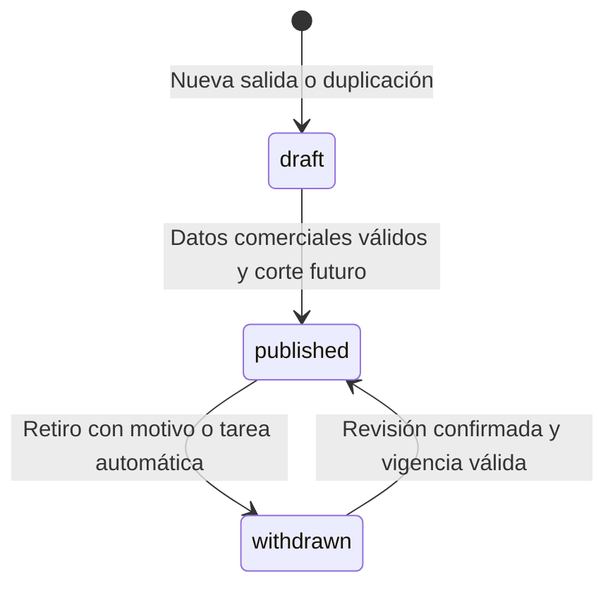

# Datos, reglas de negocio y API

## Modelo y representaciones

Una salida corresponde a una fecha de viaje de un programa. El mismo MTPE puede tener varias salidas, cada una con identidad, fecha, precio y estado propios.

Los datos recorren tres representaciones:

1. **Documento Payload:** guarda relaciones por ID, archivos de medios y campos de gestión.
2. **`Departure`:** contrato interno normalizado. Las relaciones se convierten a nombres/URLs mediante `cmsToDeparture()`.
3. **`PublicPackage`:** lista explícita de campos comerciales que se envía al navegador.

No se debe sustituir la proyección pública por una expansión del documento completo, como `{ ...doc }`. Esa sustitución podría publicar campos de gestión añadidos en el futuro.

## Colecciones y global

| Slug | Nombre en el panel | Uso |
| --- | --- | --- |
| `departures` | Salidas | Registro independiente por fecha de viaje |
| `programs` | Programas | Un MTPE único con contenido comercial compartido y versiones privadas |
| `media` | Imágenes | Archivo, texto alternativo y referencia al enlace de origen |
| `campaigns` | Promociones | Nombre, etiqueta, identificador y periodo |
| `banners` | Banners | Imágenes de campaña, enlace, periodo y orden |
| `destinations` | Destinos | Referencias reutilizables por nombre |
| `origins` | Orígenes | Ciudades de salida reutilizables |
| `cruise-lines` | Navieras | Referencias opcionales para cruceros |
| `audit-log` | Historial de cambios | Cambios comerciales y transiciones de estado |
| `users` | Usuarios | Cuentas, nombres y roles |
| `settings` | Configuración del catálogo | Global único de contacto; no es una colección de múltiples filas |

`programs` guarda `program`, `mtpe` único normalizado (sin espacios extremos, en mayúsculas), `destination`, `zone`, `days`, `nights`, `cruiseLine`, `flyer`, `flyerSourceUrl`, `flyerDownloadWarning`, `bookingUrl` y `descriptionUrl`. `departures.programRef` vincula cada fecha. Los campos compartidos antiguos se conservan como proyecciones de lectura y búsqueda para las columnas, exportación y versiones; las escrituras derivan sus valores del programa. Las actualizaciones del programa sincronizan las proyecciones en la misma transacción. Las versiones conservan sus valores históricos.

## Campos de Salidas

| Campo | Tipo/función | Observaciones |
| --- | --- | --- |
| `id` | ID de base de Payload | Se usa para abrir/actualizar el documento en el panel |
| `stableId` | UUID generado al crear | Identidad comercial estable; no editable por el cliente |
| `sourceKey` | Clave única de importación | Se conserva para actualizar sin duplicar; no se actualiza mediante la edición normal |
| `programRef` | Relación a Programas | Fuente del contenido común; los campos compartidos de esta tabla son proyecciones |
| `departureKey` | Clave privada única | MTPE + origen + fecha; protege contra duplicados, incluso con solicitudes simultáneas |
| `program`, `mtpe` | Proyecciones del programa | Nombre y código compartidos |
| `destination`, `origin` | Relaciones | Destino del programa y origen de cada salida; nombres en la representación normalizada |
| `zone` | Proyección del programa | Zona usada para filtrar |
| `cruiseLine` | Relación opcional | Naviera, si aplica |
| `days`, `nights` | Números | Días requeridos; noches opcionales |
| `travelDate` | Texto de fecha `AAAA-MM-DD` | Evita reinterpretar una fecha de salida por cambios de huso horario |
| `price` | Número | Se exige mayor que cero para publicar |
| `currency` | `USD` o `PEN` | No hay conversión automática de divisas |
| `priceCondition` | Texto requerido | Default de nuevas salidas: por persona en habitación doble |
| `flyer` | Relación a Imágenes | Tiene preferencia cuando existe una copia cargada |
| `flyerSourceUrl` | URL HTTPS opcional | Enlace de origen y alternativa para mostrar el flyer |
| `flyerDownloadWarning` | Texto de gestión | Informa si no se pudo copiar la imagen |
| `bookingUrl` | URL HTTPS | Enlace externo de reserva |
| `descriptionUrl` | URL HTTPS | Enlace externo del descriptivo |
| `promotions` | Relaciones múltiples | Una salida puede tener varias promociones |
| `priority` | Número | Valores mayores aparecen antes en Destacados |
| `advanceDays` | Entero de 0 a 3650 | Anticipación del retiro; default 30 |
| `withdrawalAt` | Instante calculado | Se recalcula al guardar; no se acepta como valor arbitrario del cliente |
| `status` | `draft`, `published`, `withdrawn` | Estado comercial propio del proyecto |
| `reviewConfirmed` | Checkbox transitorio | Necesario al reactivar; vuelve a falso después de guardar |
| `withdrawalReason` | Opción privada | Solicitud, sin stock, cambio de precio, otro o automático |
| `withdrawalNote` | Observación privada | Obligatoria para «Otro» en un retiro normal |
| `retiredAt`, `retiredBy` | Fecha y usuario | Se registran al retirar; los históricos no inventan datos ausentes |
| `sourceSheet`, `sourceRef` | Procedencia | Hoja y referencia originales |
| `sourceRetirementDate`, `sourceRetirementRaw` | Procedencia histórica | Fecha normalizada y valor original cuando no se puede atribuir un instante fiable |

Los documentos también tienen las marcas de tiempo de Payload. El historial conserva el `stableId` como `departureId`, el programa, el evento, el actor y los valores anteriores/nuevos de los campos comerciales registrados.

El `id` público de una salida normalizada desde CMS es su `stableId`. El `[id]` del preview administrativo es el ID de documento de Payload. No son intercambiables. En modo instantánea, la preparación genera otra identidad estable a partir de su clave de origen.

## Publicación, retiro y reactivación



No se permite volver desde Publicado o Retirado a Borrador, porque permitiría eludir el motivo de retiro o la revisión de reactivación. Para preparar una alternativa se puede duplicar una salida y crear otro borrador.

La publicación valida programa, MTPE, destino, origen, duración entera positiva, precio, moneda, condición, enlaces HTTPS y vigencia. Un flyer vacío permite publicar y se representa con `/megatravel-default.svg`, sin escribir ese respaldo en el programa ni en el CSV. Un enlace de flyer informado debe ser válido. La comprobación de URL valida formato y protocolo; no certifica disponibilidad, precio externo ni stock en Meganet. La revisión comercial sigue siendo responsabilidad del editor.

### Cálculo del corte

```text
Fecha de retiro = fecha de salida − advanceDays
Hora del corte = 00:00 America/Lima
```

`retirementAt()` devuelve el instante UTC correspondiente. Por ejemplo, una salida del 15 de enero de 2027 con 30 días se retira el 16 de diciembre de 2026 a las 00:00 de Lima: `2026-12-16T05:00:00.000Z`.

En el instante de corte o después, la salida deja de ser publicable. Se aplican dos mecanismos: la consulta pública excluye vencidos y una tarea programada registra el retiro en el CMS. La pestaña abierta vuelve a consultar los datos cada 30 segundos; no se promete un temporizador de cambio visual exacto al milisegundo en un navegador inactivo.

Los periodos de promociones y banners tienen inicio incluido y fin excluido. Si una promoción no tiene periodo configurado, no se inventa uno a partir de su nombre.

### Guardado e historial

`prepareDeparture` genera identificadores, resuelve el programa, rechaza fechas duplicadas, calcula el retiro y valida la transición. `prepareProgram` procesa el flyer y valida los cambios compartidos de programas con salidas vigentes. `syncProgramSnapshots` propaga el contenido común. `recordDepartureAudit` registra las diferencias y transiciones. Los contextos internos de sincronización se restauran al salir del hook para no alterar operaciones posteriores. Una reactivación registra la revisión confirmada aunque el checkbox se limpie al terminar.

Salidas conserva hasta 50 versiones por documento según su configuración actual. Historial y versiones tienen acceso privado. El proyecto bloquea el borrado de Salidas desde el acceso normal; para dejar de mostrar una salida se utiliza el estado Retirado.

## Permisos

| Operación | Público | Editor | Administrador |
| --- | --- | --- | --- |
| Consultar catálogo comercial vigente | Sí | Sí | Sí |
| Abrir medios públicos | Sí | Sí | Sí |
| Leer/escribir salidas y referencias en Payload | No | Sí | Sí |
| Consultar historial y versiones de salidas | No | Sí | Sí |
| Modificar/borrar directamente el historial | No | No | No |
| Gestionar otras cuentas y roles | No | No | Sí |
| Leer/actualizar su propia cuenta | No | Sí, con restricciones de rol | Sí |
| Gestionar Configuración del catálogo | No | No | Sí |
| Importar históricos incompletos por la herramienta HTTP | No | No | Sí |
| Borrar salidas mediante el acceso normal | No | No | No |

Las operaciones internas autorizadas, como el registro de historial o el cron, usan acceso de servidor de forma explícita. El navegador no elige esos contextos internos como parte de los campos comerciales.

## API pública

### `GET /api/public/catalog`

Devuelve `CatalogData` con estas propiedades:

| Propiedad | Contenido |
| --- | --- |
| `packages` | Array de `PublicPackage` publicado y vigente |
| `promotions` | Promociones activas para los accesos de filtro |
| `banners` | Banners activos y habilitados |
| `contactUrl`, `contactLabel` | Contacto configurado o valor de respaldo |

Cada paquete contiene únicamente `id`, `program`, `mtpe`, `destination`, `zone`, `origin`, `cruiseLine`, `days`, `nights`, `travelDate`, `price`, `currency`, `priceCondition`, `flyerUrl`, `bookingUrl`, `descriptionUrl`, `promotions` y `priority`. Las promociones públicas contienen ID, nombre y etiqueta.

La respuesta no incluye motivos, notas, responsables, claves de importación, usuarios ni historial. Devuelve `Cache-Control: no-store`. Si el origen de datos falla, responde 503 con un mensaje público genérico.

Este endpoint no admite escritura. Tampoco procesa los parámetros del buscador como consulta paginada de base: la interfaz filtra los paquetes recibidos.

### Parámetros de la URL del catálogo

| Parámetro | Ejemplo | Interpretación |
| --- | --- | --- |
| `q` | `q=10035` | Programa, destino, MTPE, zona u origen; texto normalizado |
| `zones` | `zones=EUROPA&zones=ASIA` | Una o varias zonas |
| `destinations` | `destinations=MADRID` | Destinos |
| `origins` | `origins=LIMA` | Orígenes |
| `months` | `months=2027-03` | Mes/año de salida |
| `programs` | `programs=MAGIA+EUROPEA` | Nombres exactos de programas seleccionados |
| `promotions` | `promotions=semana-santa` | Identificadores de promoción |
| `cruiseLines` | `cruiseLines=MSC` | Navieras |
| `from`, `to` | `from=2027-03-01&to=2027-03-31` | Intervalo incluido; mismo día en ambos significa fecha exacta |
| `sort` | `featured`, `date`, `price-asc`, `price-desc`, `duration` | Orden |
| `page` | `page=2` | Página; tamaño actual de 12 |

Dentro de un filtro se aplica OR; entre filtros, AND. Los parámetros no válidos se normalizan. El orden por precio agrupa por moneda y no convierte USD/PEN; comparar monedas distintas como si fueran el mismo valor requeriría otra regla comercial.

## Herramientas HTTP privadas

Todas las herramientas requieren sesión de editor o administrador. En POST también se comprueba `Origin` contra el origen configurado por `NEXT_PUBLIC_SITE_URL`. No requieren poner contraseñas en el cuerpo de cada petición: se autentican mediante la sesión/credenciales que Payload reconoce.

| Método y ruta | Entrada | Resultado |
| --- | --- | --- |
| `GET /api/admin-tools/options` | Sin cuerpo | Datos resumidos de salidas para elegir una plantilla |
| `GET /api/admin-tools/programs` | Sin cuerpo | Programas para el formulario Nueva salida |
| `POST /api/admin-tools/create-departures` | JSON con programa nuevo o `programId`, condiciones y fechas | Programa y 1–30 borradores en una transacción; enlaces de edición y preview |
| `GET /api/admin-tools/export` | Sin cuerpo | CSV de gestión completo y privado |
| `POST /api/admin-tools/duplicate` | JSON de plantilla y fechas/precios | Borradores independientes con enlaces para editarlos |
| `POST /api/admin-tools/import` | Formulario multipart con CSV y opciones | Reporte por fila, en validación o escritura |
| `POST /api/admin-tools/images` | JSON opcional con `id` | Copia/reintento de hasta 50 flyers por operación |

Ejemplo de estructura para duplicar; los valores son ilustrativos:

```json
{
  "sourceId": "123",
  "departures": [
    { "date": "2027-06-15", "price": 3599 },
    { "date": "2027-07-15", "price": 3799 }
  ]
}
```

Se aceptan entre 1 y 30 fechas por operación. Se comprueban fechas repetidas y salidas existentes con mismo MTPE, origen y fecha. La duplicación reutiliza `programRef`; crea borradores sin copiar motivo de retiro ni procedencia. Programa, referencias nuevas, salidas, auditoría y versiones se guardan en una transacción: cualquier error revierte el lote. SQLite local activa `transactionOptions`; PostgreSQL utiliza las transacciones del adaptador.

El alta acepta `programId` o `program: { program, mtpe, destination, zone, days, nights?, cruiseLine?, flyer?, flyerSourceUrl?, bookingUrl?, descriptionUrl? }`; destino/naviera/origen nuevos se resuelven por nombre. Las condiciones son `origin`, `currency` (USD por defecto), `priceCondition`, `advanceDays` (30), `priority`, `promotions` y `departures: [{ date, price }]`. Las promociones se pueden ajustar por fecha en Payload.

También acepta multipart con `data` (el mismo JSON) y `flyer` (archivo opcional JPEG/PNG/WebP/GIF de hasta 12 MB, solo para programas nuevos). El formulario usa esta variante: el registro de imagen forma parte de la transacción. Límite total de solicitud: 13 MB. Si se revierte una carga, el almacenamiento puede conservar un archivo físico sin registro; se puede limpiar como medio huérfano, sin publicar una salida parcial.

`/admin` redirige a la tabla de Salidas. `mtView=published|expiring|draft|withdrawn` identifica la vista persistente; el filtro base se evalúa en el servidor y se combina con búsqueda/filtros de Payload. Publicadas excluye el corte alcanzado; Próximas incluye el corte futuro hasta siete días; Retiradas combina retiradas explícitas con publicadas vencidas.

### Importación HTTP

| Campo multipart | Comportamiento |
| --- | --- |
| `file` | CSV de hasta 5 MB; máximo 5000 filas |
| `dryRun` | Solo la cadena `false` activa escritura; de otro modo se valida |
| `downloadImages` | La cadena `true` intenta copiar los flyers |
| `historical` | La cadena `true` permite la importación histórica, limitada a administrador |

El reporte contiene `dryRun`, `total`, `accepted`, `errors` y resultados por fila. Las filas inválidas se reportan individualmente. Un fallo de descarga puede conservar el enlace y producir una advertencia sin rechazar la fila completa. La validación sin importar no garantiza la disponibilidad posterior del servidor de imágenes.

La importación agrupa por MTPE y rechaza todo grupo con valores comunes contradictorios en el archivo, conservando los encabezados y `source_key`. Cada grupo aceptado actualiza su programa y fechas dentro de una transacción. La exportación resuelve el contenido vigente del programa y conserva vacío `flyer_url` cuando no hay arte original.

Los banners públicos incluyen `placement` (`hero`, `between-results`, `catalog-end`), `order`, periodo, URLs comerciales y texto alternativo. Los anteriores sin ubicación se proyectan como `hero`. Se carga la imagen visible del hero con prioridad alta; las inferiores se difieren. No se envían campos administrativos adicionales.

La interfaz pide validar antes de habilitar el botón de importación. El servidor vuelve a validar: el botón no reemplaza las reglas de acceso y guardado.

## Payload, cron y salud

- `/admin` y sus subrutas son el panel administrativo.
- `/api/[...slug]` es la API de Payload, con los permisos de cada colección. Salidas no tiene lectura pública directa; Imágenes sí permite lectura de medios, con el enlace original restringido en sus metadatos.
- `GET /preview/[id]` es privado, exige editor autenticado y tiene metadatos que desaconsejan indexación.
- `POST /api/cron/retire` exige `Authorization: Bearer …` igual a `CRON_SECRET`, de al menos 32 caracteres. Una clave ausente/inválida devuelve 503/401. Los fallos de ejecución devuelven 500.
- `GET /api/health` devuelve modo y estado. En `workbook` no comprueba PostgreSQL; en modo CMS realiza una consulta de disponibilidad de Salidas. Un estado correcto en modo instantánea no prueba que el CMS esté listo para producción.

El cron también puede usar `npm run retire`, dentro del servidor y con variables de entorno propias. La agenda no está creada por el repositorio.

## CSV y traslado desde Excel

Los encabezados de CSV están definidos en el exportador y en `scripts/prepare-workbook.mjs`. Los campos completos aparecen en el README y el código. Las promociones múltiples usan `|`. Los estados son valores internos en inglés; el panel los traduce.

### Migración de salidas existentes a Programas

La migración de datos está en `src/server/program-migration.ts` y su CLI es `npm run migrate:programs`. El CLI prepara la SQLite local antigua con una copia completa y reconstrucción atómica del esquema; verifica todas las columnas originales y evita los índices duplicados que genera Drizzle. Para bases SQLite nuevas sigue disponible el push de desarrollo. Para PostgreSQL están generadas las migraciones de esquema en `src/migrations/`; hay que revisarlas y probarlas en staging antes de usar el código nuevo en producción.

1. Antes del cambio, crea una copia completa de PostgreSQL (`npm run backup`) y conserva medios, versiones e historial. Suspende las escrituras del equipo durante la migración.
2. Ejecuta `npm run migrate:programs`. Prepara archivos privados `backups/programas-*.backup.json` y `.report.json`: documentos originales, huella de integridad, referencia elegida por MTPE y cada valor común que se reemplazará. Si la SQLite local necesita el esquema nuevo, lo prepara primero con copia completa; todavía no unifica los datos comerciales.
3. Revisa el reporte. La referencia es la salida publicada y vigente editada más recientemente; en su ausencia, la más recientemente editada. Los empates se resuelven por ID descendente. El MTPE se normaliza; grupos distintos permanecen aislados.
4. Ejecuta `npm run migrate:programs -- --commit`. Crea un respaldo nuevo y un manifiesto `.applied.json` antes de confirmar la transacción. Vincula las salidas mediante `programRef` y asigna banners antiguos al hero. No modifica IDs, fechas, precios, estados, procedencia, marcas de tiempo, versiones ni Historial. Los campos comunes actuales se sustituyen conforme al reporte. Los duplicados históricos conservan sus IDs y una clave de unicidad nula; no se permiten duplicados nuevos.
5. Repetir el comando omite salidas ya vinculadas y conserva las ediciones posteriores de Programas. Si los datos cambian entre respaldo y escritura, se rechaza el respaldo desactualizado.
6. Para revertir, usa `npm run migrate:programs -- --down backups/programas-….backup.json`, junto a su `.applied.json`. Restaura los valores originales y elimina únicamente los programas creados por ese lote. Se niega a sobrescribir ediciones posteriores o programas que ya tengan salidas nuevas. La reversión se puede repetir.

La migración de datos se verificó con SQLite aislada; no equivale a una migración de esquema PostgreSQL ni valida el almacenamiento R2.

El parser admite BOM, comas o punto y coma, campos entrecomillados y saltos dentro de campos. Rechaza encabezados duplicados, columnas inconsistentes y comillas sin cerrar. Las fechas de entrada aceptadas se normalizan desde ISO, día/mes/año o seriales de Excel. No se adivina el año de una fecha incompleta.

`source_key` identifica una fila entre importaciones. Si falta, se requiere `source_sheet` más `source_ref` para construir una clave. El importador detecta repetidos dentro del archivo y consulta la base para actualizar registros ya existentes. No reactiva automáticamente una salida que el CMS ya tenga retirada, y conserva el motivo/observación vigente de un registro retirado existente.

### Mapeo del Excel actual

| Columna | Contenido | Destino |
| --- | --- | --- |
| A | Mes | Contexto; las fechas se toman de E |
| B | MTPE | `mtpe` sin el sufijo numérico `.0` |
| C | Programa | `program` |
| D | Días/noches | `days` y `nights` |
| E | Salida | `travelDate` |
| F | Zona | `zone` |
| G | Origen | Referencia de origen |
| H | Destino | Referencia de destino |
| I | Meganet | `bookingUrl`, respetando el hipervínculo disponible |
| J | Café | `descriptionUrl` |
| K | Precio | `price` numérico |
| L | Foto | Enlace de flyer |
| M | Año/mes | Contexto; no reemplaza la fecha de E |
| N | Crucero | Naviera |
| O | Promoción/promociones | Referencias de promociones |
| P, Q | Cupón/orden de días | Sin equivalencia funcional específica en el modelo actual |
| R | Días de retiro | `advanceDays`, con default de 30 |
| S | Fecha de retiro histórica | Procedencia normalizada y valor original |
| T | Motivo de retiro histórico | Motivo interpretable y observación original |

La moneda y condición USD por persona en habitación doble fueron confirmadas por el usuario, porque el Excel no las declara como columnas. El script considera activa la primera hoja, conserva los otros estados históricos y excluye la hoja que empieza por `BACKUP` de la publicación/importación normalizada; su contenido permanece en la extracción original.

El reporte inicial registra 411 filas preparadas, con 233 publicables, 10 borradores y 168 históricos. Es un corte de la preparación inicial, no un contador permanente de salidas disponibles. Las 10 filas incompletas y sus referencias están en [el reporte de preparación](../migration/workbook-report.json).
