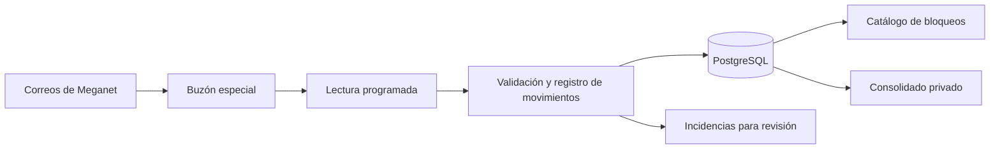

# Plan futuro: automatización de cupos y consolidado web

**Estado: propuesta para implementación posterior.** Este documento recoge el análisis y las decisiones conversadas; no acredita la configuración de correo, la importación de datos ni el despliegue de esta funcionalidad. Fecha del análisis: 2 de noviembre de 2026.

## Objetivo y viabilidad

Actualizar automáticamente los cupos mostrados en el catálogo de bloqueos y ofrecer un consolidado web privado con filtros y exportación. La entrada de movimientos serán los correos de reservas y sus cambios; Meganet seguirá siendo el sistema donde se realizan las reservas.

La arquitectura existente de Next.js, Payload, PostgreSQL y Railway admite esta ampliación. Ambas vistas consultarán la misma base. La coincidencia de los saldos con Meganet dependerá de contar con un saldo inicial conciliado y recibir todos los avisos relevantes. Debe confirmarse si el correo corporativo utiliza Exchange Online y examinar ejemplos reales antes de diseñar el lector definitivo.

## Regla de cupos y modelo

Se conservará un único programa por MTPE y se crearán hasta dos bolsas independientes por programa: **bloqueo** y **tarifa publicada**. Cada salida se asociará a su tipo y compartirá el saldo de esa bolsa con las demás fechas del mismo MTPE y tipo. Las bolsas incluyen los distintos orígenes de las salidas asociadas.

Ejemplo confirmado: si cuatro fechas de tarifa publicada comparten 15 sillas y dos fechas de bloqueo comparten 9, una reserva de 3 sillas en una fecha de tarifa publicada deja 12 en las cuatro fechas de ese tipo; las dos fechas de bloqueo mantienen 9.

Cada bolsa tendrá capacidad total, saldo disponible, saldo inicial y fecha de corte, modalidad manual o automática, última conciliación y estado de la integración. La migración conservará los valores e historial existentes: no duplicará automáticamente el saldo antiguo en ambas bolsas. Los grupos se clasificarán y conciliarán antes de activar la automatización.

Los formularios de creación y duplicación permitirán seleccionar el tipo por fecha. La identificación de salidas debe admitir una misma combinación de MTPE, origen y fecha para tipos distintos. Los cambios de contenido compartido se mantendrán en Programas; las reglas actuales de publicación y retiro permanecerán separadas del estado operativo del bloqueo.

## Tratamiento de correos y reservas

Si se confirma Exchange Online, se usará Microsoft Graph con una aplicación de Microsoft Entra ID y OAuth 2.0, autorizada por TI para lectura del buzón especial. El acceso se limitará a ese buzón mediante Application RBAC, sin concesiones globales adicionales que eliminen esa limitación. La aplicación no necesita enviar correos ni modificar el buzón. [Application RBAC de Exchange Online](https://learn.microsoft.com/en-us/exchange/permissions-exo/application-rbac).

Una tarea de Railway consultará los cambios cada diez minutos mediante la consulta incremental de Graph, guardando su progreso y recuperándose de reinicios. La ejecución terminará al completar su trabajo y respetará los reintentos indicados por Graph. Railway puede retrasar ejecuciones y omite una ejecución si la anterior sigue activa. [Delta de mensajes](https://learn.microsoft.com/en-us/graph/api/message-delta?view=graph-rest-1.0) y [cron de Railway](https://docs.railway.com/reference/cron-jobs).

Los mensajes deberán permitir obtener identificador de reserva, MTPE, fecha, cantidad de sillas consumidas, tipo de evento y fecha o versión del cambio. El tipo de bolsa podrá deducirse de la salida cuando exista una coincidencia única. Si falta información, hay ambigüedad, el orden no es fiable o el movimiento produce un saldo incoherente, se registrará una incidencia para revisión. Mover o borrar un correo no equivale a cancelar la reserva.

El sistema conservará el estado de cada reserva y aplicará solo la diferencia respecto de su estado anterior:

| Evento | Efecto |
| --- | --- |
| Reserva nueva de 3 sillas | Descontar 3 |
| Confirmación de venta de esa reserva | No volver a descontar |
| Modificación de 3 a 2 | Devolver 1 |
| Cancelación o vencimiento que libera las 2 restantes | Devolver 2 |

Se registrarán mensajes, reservas y movimientos con mecanismos de deduplicación tanto del correo como del evento de negocio. Los cambios, incluidos traslados entre bolsas, se aplicarán transaccionalmente. Los ajustes manuales tendrán responsable, motivo y trazabilidad, sin reiniciar la identificación de reservas procesadas.

Antes de activar una bolsa se registrará su saldo conciliado y fecha de corte. Las reservas vigentes conocidas se identificarán para evitar descuentos repetidos; los cambios posteriores de reservas anteriores desconocidas requerirán revisión. Se distinguirán la última lectura del buzón, el último movimiento aplicado y la última conciliación: consultar un buzón sin novedades no confirma el saldo. La vigencia inicial de conciliación será la existente de 72 horas; una interrupción de lectura superior a 30 minutos marcará la integración desactualizada y ocultará la cantidad pública hasta su revisión.

## Consolidado privado y experiencia de uso

La referencia de diseño será únicamente la hoja **PROPUESTA** del archivo local `Images/CONSOLIDADO BLOQUEOS (1).xlsx`. No se cargarán ni actualizarán sus datos en esta etapa. El catálogo deberá usar `CATALOG_SOURCE=cms` para consultar cambios persistidos; el modo `workbook` es una instantánea y no se actualiza con la base.

El subdominio utilizará las cuentas existentes de Payload y añadirá un rol de consulta. La tabla será inicialmente de solo lectura y dispondrá de búsqueda, filtros combinables por columna, ordenamiento, rango de fechas, encabezados fijos y exportación XLSX y CSV. Presentará las columnas de PROPUESTA: mes, MTPE, zona, programa, días/noches, fecha de salida, tipo, sillas totales y disponibles, estado y fecha de anulación. También mostrará el estado de actualización.

Las filas que comparten una bolsa mostrarán el mismo saldo; los resúmenes contarán cada bolsa una sola vez. Las altas y correcciones se realizarán desde Payload. La lógica de ajustes quedará centralizada para habilitar edición desde la tabla en una fase futura. El Excel original no será una segunda fuente operativa: las exportaciones se generarán desde la base. Los datos faltantes necesarios para publicar, como precios o enlaces, deberán completarse antes de publicar nuevas salidas.

Se incorporarán endpoints autenticados de consulta y exportación, y el catálogo público recibirá únicamente los campos comerciales permitidos. La configuración actual de origen, CSRF y autenticación debe adaptarse a ambos dominios. El enrutamiento por subdominio debe usar las convenciones de la versión de Next instalada y no sustituye la autorización en el servidor.

## Tecnologías y requisitos

- **Existentes:** Next.js, React, TypeScript, Payload, PostgreSQL y Railway.
- **Correo:** Microsoft Graph, Microsoft Entra ID, OAuth 2.0 y MSAL para Node.js, sujetos a confirmar Exchange Online.
- **Extracción:** reglas para plantillas verificadas, análisis de HTML y validación de campos. La primera versión no requiere IA.
- **Vista y archivos:** TanStack Table y ExcelJS, más el exportador CSV existente.
- **Infraestructura:** tarea cron, DNS y HTTPS del subdominio, credenciales protegidas, copias de seguridad y monitoreo de incidencias.

Para verificar el proveedor, en Outlook clásico se puede revisar **Archivo → Configuración de la cuenta → Configuración de la cuenta** y el tipo de cuenta. TI debe confirmar específicamente si el buzón está alojado en Exchange Online de Microsoft 365, pues Exchange también puede estar alojado localmente. Si se utiliza otro proveedor, se reevaluará el conector antes de desarrollar la lectura automática.

TI y operaciones deberán confirmar que pueden crear el buzón, autorizar la aplicación y recibir copias de reservas, ventas, modificaciones, cancelaciones y vencimientos. Se necesitarán ejemplos anonimizados de cada plantilla y una confirmación de cómo se representan las sillas y sus liberaciones. Los datos privados de pasajeros no se incluirán en el consolidado ni en respuestas públicas.

Un buzón compartido de hasta 50 GB puede no requerir licencia adicional si la organización cumple los requisitos de Exchange Online. La lectura de correo propuesta no figura entre las APIs de Graph facturadas por llamada; las licencias de correo siguen aplicando. El costo adicional de cron, almacenamiento y exportaciones debe medirse antes de cerrar el presupuesto. [Buzones compartidos](https://learn.microsoft.com/en-us/microsoft-365/admin/email/about-shared-mailboxes?view=o365-worldwide) y [APIs de Graph con facturación por consumo](https://learn.microsoft.com/en-us/graph/metered-api-list).

## Etapas y aceptación

1. Confirmar proveedor, permisos y cobertura de eventos; revisar ejemplos reales y definir el tratamiento manual de lo que no pueda identificarse.
2. Implementar bolsas por MTPE y tipo, migración conservadora, acceso privado, filtros y exportaciones con datos de prueba. No importar datos reales en esta etapa.
3. Ejecutar la lectura en simulación, registrando movimientos propuestos sin alterar los cupos visibles.
4. Realizar un piloto de siete días con bolsas seleccionadas y saldo inicial conciliado; comparar los resultados con Meganet.
5. Activar progresivamente las bolsas verificadas, con incidencias visibles, respaldo y opción de regresar a gestión manual.

Las pruebas deberán cubrir la independencia de las dos bolsas; reservas, confirmaciones, modificaciones y cancelaciones; cambios entre tipos; duplicados y reenvíos; eventos antiguos o ambiguos; recuperación y concurrencia en PostgreSQL; y saldos incoherentes. Se comprobarán acceso privado, rol de consulta, filtros y exportaciones, coherencia entre ambas vistas y conservación de precios, publicación y retiros. Las migraciones y el flujo completo se validarán en staging antes del lanzamiento.

En el análisis previo se revisó la arquitectura y pasaron 55 pruebas existentes. Esas pruebas no validan la integración de correo ni el despliegue futuro.
