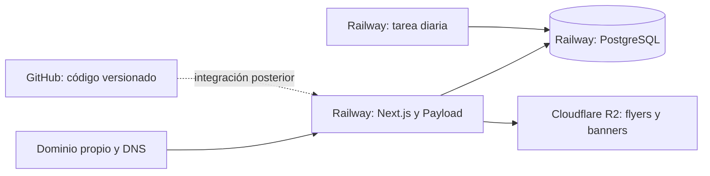

# Producción: dominio, hosting y proveedores

## Respuesta para este proyecto

**No necesitas comprar otro hosting si utilizas Railway para ejecutar la aplicación.** Railway aloja el proceso Next.js/Payload y puede alojar PostgreSQL y el servicio programado. El dominio puede seguir registrado donde lo compraste, incluido Hostinger. Conectarlo mediante DNS es diferente de trasladar su registro. Railway ofrece dominios propios y conexión de dominios personalizados con HTTPS. [Red pública y dominios de Railway](https://docs.railway.com/networking/public-networking).

La arquitectura preparada utiliza además Cloudflare R2 para las imágenes. Por tanto, la elección actual es Railway para aplicación/base/tarea y R2 para archivos; no dos hostings web para la misma aplicación.

La flecha de GitHub representa una integración futura. Hacer un commit o un push no publica este proyecto mientras no se configure el alojamiento para desplegarlo.

## Qué necesitas contratar o tener disponible

| Elemento | Función | Situación/decisión |
| --- | --- | --- |
| Dominio y acceso al DNS | Dirección pública del catálogo | Ya tienes dominio; se necesitará acceso a sus registros |
| Alojamiento de aplicación Node | Mantener Next.js y Payload en ejecución | Railway es la opción prevista |
| PostgreSQL persistente | Contenido, cuentas, relaciones, historial | Puede estar en el mismo proyecto de Railway |
| Almacenamiento persistente de imágenes | Flyers y banners que sobrevivan a reinicios/despliegues | R2, con acceso S3 para cargas y URL pública de medios |
| Programador de tareas | Registrar retiros diarios | Servicio cron o programador HTTP de confianza |
| Variables y secretos del entorno | Conectar y autenticar los servicios | Tabla completa en [configuración](configuracion.md) |
| Administrador del CMS | Crear editores y configurar el contenido | Se crea mediante bootstrap privado |
| Backups y restauración comprobada | Recuperar base e imágenes | Deben prepararse antes de la puesta en marcha |
| Repositorio GitHub | Versionar y distribuir el código | Lo creó el usuario; la vinculación/push la realizará el usuario |

No hace falta un servidor separado para el frontend y otro para el CMS. Ya comparten la aplicación. El almacenamiento de imágenes y la base siguen siendo recursos persistentes diferentes al código.

## ¿Se puede usar Hostinger?

Sí, pero hay que elegir un producto adecuado. Hostinger declara soporte Node.js en Business Web Hosting y planes Cloud, y también VPS para configuraciones con mayor control. Un plan orientado únicamente a archivos estáticos o WordPress no garantiza los requisitos de esta aplicación. [Opciones Node.js de Hostinger](https://www.hostinger.com/support/node-js-hosting-options-at-hostinger/).

| Opción | Encaje con el código actual | Trabajo que queda por verificar |
| --- | --- | --- |
| Railway | Configuración Docker y salud ya preparadas; PostgreSQL puede convivir en el proyecto | Build, esquema, almacenamiento, tareas, copias, dominio y validación |
| Hostinger con Node administrado | Puede alojar Node; no se ha probado esta aplicación allí | Versión mínima, proceso persistente, recursos, paquetes nativos como Sharp, conexión PostgreSQL y ejecución de tareas |
| Hostinger VPS | Permite controlar Node, Docker y servicios | Administrar sistema, despliegues, HTTPS/proxy, actualizaciones, base, tareas y backups |

La recomendación para este código es mantener Railway y R2, porque es la arquitectura ya preparada y requiere menos administración de un servidor propio. Es una elección de proyecto, no una afirmación de que Hostinger sea incompatible.

Si solo usas Hostinger como registrador de dominio, no necesitas contratar allí también un hosting web para conectarlo a Railway.

## ¿Puede estar todo en Railway?

La aplicación y PostgreSQL pueden concentrarse allí. Para imágenes, el código actual activa un adaptador S3 configurado con variables `R2_*` y genera una URL pública. Sustituir R2 por otro almacenamiento requiere comprobar compatibilidad de carga, URLs públicas, permisos, persistencia y respaldos; no se considera integrado solo por contratarlo.

También habría que resolver el directorio persistente si se optara por guardar imágenes en disco. El disco temporal de un contenedor no sustituye un almacenamiento de archivos permanente. Mantener R2 conserva la separación que ya contempla el proyecto.

## Conectar el dominio cuando llegue el lanzamiento

1. Validar primero la aplicación con una URL de prueba y los servicios de staging.
2. Añadir el dominio definitivo al servicio de la aplicación en Railway.
3. Copiar exactamente los registros DNS que muestre el proveedor. No inventar la IP o el destino de un CNAME. La documentación vigente de Railway indica registros CNAME y TXT para su conexión de dominio personalizado.
4. Añadirlos en el proveedor que gestiona actualmente el DNS del dominio. El registrador y el proveedor DNS pueden ser diferentes.
5. Conservar los registros de otros servicios, como correo. Si se decide mover nameservers a Cloudflare para gestionar el dominio de medios, revisar antes todos los registros existentes.
6. Configurar la URL definitiva en el entorno de la aplicación y revisar origen permitido, enlaces y analítica.
7. Comprobar resolución, HTTPS, catálogo, login y enlaces antes de dar el cambio por completado.

Railway gestiona emisión y renovación de certificados para su red pública. La configuración exacta depende del dominio y de los registros que proporcione el panel. [Configuración de dominio en Railway](https://docs.railway.com/networking/public-networking).

Para las imágenes puede usarse un subdominio como `imagenes.tudominio.com`. En R2, los dominios personalizados son la opción para servicio público de producción; `r2.dev` está orientado a desarrollo y tiene límites de acceso. [Buckets públicos de R2](https://developers.cloudflare.com/r2/buckets/public-buckets/).

## Costes: cómo interpretarlos

Consulta de tarifas realizada el 23 de octubre de 2026; hay que revisarlas antes de contratar.

- Railway publica un mínimo de uso de USD 5 para Hobby y USD 20 para Pro, con crédito de consumo incluido en cada nivel. El coste final depende de recursos y uso: no se debe interpretar el mínimo como una cotización completa de aplicación, base y backups. [Precios de Railway](https://railway.com/pricing).
- R2 cobra almacenamiento y operaciones; su clase Standard tiene una franquicia mensual y el tráfico de salida no tiene cargo de egress según su tabla. Estar dentro de la franquicia depende del consumo real. [Precios de R2](https://developers.cloudflare.com/r2/pricing/).
- El dominio mantiene su renovación con el registrador. Mover el alojamiento de la aplicación no elimina ese coste.
- Las tarifas de un VPS o plan Node de Hostinger se deben comparar con su periodo de renovación, recursos y trabajo de administración, no solo con un precio promocional inicial.

Para cotizar se necesitan tráfico previsto, tamaño total de archivos, recursos medidos de aplicación/base, política de copias y plan del proveedor. No se contrataron servicios ni se emitió una cotización cerrada durante la documentación.

## Lo que falta antes de publicar

El repositorio tiene instrucciones y configuración, pero no una migración PostgreSQL inicial aprobada. También se deben completar build, integración real con CMS, validación de escritorio/móvil, descarga de imágenes, credenciales de servicios y restauración de prueba. La presencia de `node_modules/` o `.next/` no equivale a aceptación de producción.

Los pasos operativos están en [operación y lanzamiento](operacion.md). Se mantienen pendientes porque el usuario pidió resolver primero documentación y preparación del repositorio.
