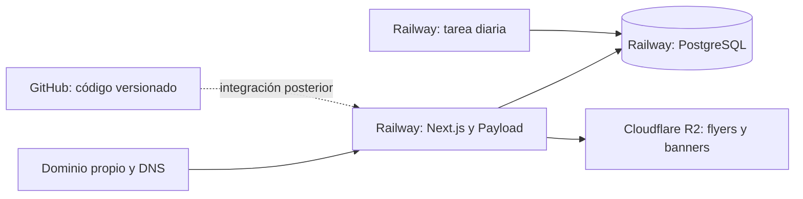

# Producción: dominio, hosting y proveedores

## Respuesta para este proyecto

El usuario confirmó la arquitectura **Next.js con Payload como CMS, PostgreSQL y Railway**. Primero se debe configurar y validar el entorno local; después completar migraciones, persistencia, tareas y copias antes de publicar. Ver [configuración del CMS](cms.md), [pruebas locales](pruebas-locales.md) y [presupuesto](costos-railway.md).

**No necesitas comprar otro hosting si utilizas Railway para ejecutar la aplicación.** Railway aloja el proceso Next.js/Payload y puede alojar PostgreSQL y el servicio programado. El dominio puede seguir en su registrador actual. Conectarlo mediante DNS es diferente de trasladar su registro. Railway ofrece dominios propios y conexión de dominios personalizados con HTTPS. [Red pública y dominios de Railway](https://docs.railway.com/networking/public-networking).

La arquitectura preparada admite Cloudflare R2 para las imágenes, como muestra el diagrama. También se puede utilizar un volumen persistente de la aplicación en Railway. La elección del almacenamiento se configura sin cambiar el CMS; el editor continúa subiendo archivos desde Payload.

La flecha de GitHub representa una integración futura. Hacer un commit o un push no publica este proyecto mientras no se configure el alojamiento para desplegarlo.

## Servicios para producción

| Elemento | Función | Situación/decisión |
| --- | --- | --- |
| Dominio y acceso al DNS | Dirección pública del catálogo | Ya tienes dominio; se necesitará acceso a sus registros |
| Alojamiento de aplicación Node | Mantener Next.js y Payload en ejecución | Railway es la opción prevista |
| PostgreSQL persistente | Contenido, cuentas, relaciones, historial | Puede estar en el mismo proyecto de Railway |
| Almacenamiento persistente de imágenes | Flyers y banners que sobrevivan a reinicios/despliegues | R2, con acceso S3 para cargas y URL pública de medios |
| Programador de tareas | Registrar retiros diarios | Servicio cron o programador HTTP de confianza |
| Variables y secretos del entorno | Conectar y autenticar los servicios | Tabla completa en [configuración](configuracion.md) |
| Administrador del CMS | Crear editores y configurar el contenido | Se crea mediante bootstrap privado |
| Backups y restauración comprobada | Recuperar base e imágenes | Deben prepararse antes de la puesta en marcha |
| Repositorio GitHub | Versionar y distribuir el código | Lo creó el usuario; la vinculación/push la realizará el usuario |

No hace falta un servidor separado para el frontend y otro para el CMS. Ya comparten la aplicación. El almacenamiento de imágenes y la base siguen siendo recursos persistentes diferentes al código.

## ¿Puede estar todo en Railway?

Sí: aplicación y CMS juntos, PostgreSQL y un volumen persistente de imágenes. Para esa opción, dejar `R2_BUCKET` vacío, mantener `MEDIA_DIR=/app/media` y montar el volumen de la aplicación en `/app/media`, además del volumen propio de PostgreSQL. La ruta está preparada en el código y Dockerfile; faltan comprobar montaje, permisos del usuario `node`, cargas, copias y persistencia después de desplegar. El disco temporal del contenedor no sustituye al volumen.

Railway también ofrece buckets S3 privados, sin URL pública directa equivalente a `R2_PUBLIC_URL`. Usarlos requiere adaptar la entrega mediante URLs firmadas o proxy, por lo que no son un reemplazo integrado de R2 con solo cambiar credenciales. [Archivos en Railway](https://docs.railway.com/guides/storage-buckets-guide).

Mantener R2 permite servir flyers desde su dominio público y aprovechar su franquicia y salida de datos sin cargo. El [presupuesto Railway](costos-railway.md) compara este camino con concentrar todo mediante volúmenes; la [guía CMS](cms.md) reúne las variables de ambas opciones.

## Conectar el dominio cuando llegue el lanzamiento

1. Validar primero la aplicación con una URL de prueba y los servicios de staging.
2. Añadir el dominio definitivo al servicio de la aplicación en Railway.
3. Copiar exactamente los registros DNS que muestre el proveedor. No inventar la IP o el destino de un CNAME. La documentación vigente de Railway indica registros CNAME y TXT para su conexión de dominio personalizado.
4. Añadirlos en el proveedor que gestiona actualmente el DNS del dominio. El registrador y el proveedor DNS pueden ser diferentes.
5. Conservar los registros de otros servicios, como correo. Si se decide mover nameservers a Cloudflare para gestionar el dominio de medios, revisar antes todos los registros existentes.
6. Configurar la URL definitiva en el entorno de la aplicación y revisar origen permitido, enlaces y analítica.
7. Comprobar resolución, HTTPS, catálogo, login y enlaces antes de dar el cambio por completado.

Railway gestiona emisión y renovación de certificados para su red pública. La configuración exacta depende del dominio y de los registros que proporcione el panel. [Configuración de dominio en Railway](https://docs.railway.com/networking/public-networking).

Para las imágenes puede usarse un subdominio como `imagenes.tudominio.com`. En R2, los dominios personalizados son la opción para servicio público de producción; `r2.dev` está orientado a desarrollo y tiene límites de acceso. [Buckets públicos de R2](https://developers.cloudflare.com/r2/buckets/public-buckets/).

## Costes: cómo interpretarlos

Consulta de tarifas actualizada el 24 de octubre de 2026; hay que revisarlas antes de contratar. El cálculo completo con supuestos y ejemplos está en [costos aproximados de Railway](costos-railway.md).

- Railway publica un mínimo de uso de USD 5 para Hobby y USD 20 para Pro, con crédito de consumo incluido en cada nivel. El coste final depende de recursos y uso: no se debe interpretar el mínimo como una cotización completa de aplicación, base y backups. [Precios de Railway](https://railway.com/pricing).
- R2 cobra almacenamiento y operaciones; su clase Standard tiene una franquicia mensual y el tráfico de salida no tiene cargo de egress según su tabla. Estar dentro de la franquicia depende del consumo real. [Precios de R2](https://developers.cloudflare.com/r2/pricing/).
- El dominio mantiene su renovación con el registrador. Mover el alojamiento de la aplicación no elimina ese coste.
- El presupuesto con Payload incluye aplicación, base, medios, tareas y copias. Las cuentas del CMS no añaden una tarifa de licencia por editor en esta implementación.

El usuario informa unas 1,000 personas mensuales. Con RAM media conjunta de app/base de 0.60–0.90 GB y CPU baja, se calcula un escenario pequeño de USD 7–12/mes en Hobby y un presupuesto inicial con margen de USD 15. Diez GB de tráfico representarían solo USD 0.50; el gasto principal del ejemplo es la memoria permanente. Son supuestos sin métricas del despliegue: más memoria, tráfico o entornos permanentes pueden superar USD 20. Pro ya tiene un mínimo de USD 20. El [desglose actualizado](costos-railway.md) explica el catálogo dinámico actual y las opciones para servir contenido estático. No se contrataron servicios ni se emitió una cotización cerrada.

## Lo que falta antes de publicar

El 24 de octubre se actualizó Node a 24.22.1 LTS y se repitieron correctamente tipos, pruebas, integración con Payload/SQLite y build local. El último build terminó sin advertencias de compilación. El repositorio todavía no tiene una migración PostgreSQL inicial aprobada. Quedan validación PostgreSQL y contenedor, escritorio/móvil, correo, imágenes persistentes, credenciales de servicios y restauración de prueba. Los resultados y su alcance se registran en [continuidad](continuidad.md).

Los pasos operativos están en [operación y lanzamiento](operacion.md). Documentar esos pasos no equivale a ejecutarlos ni a validar servicios externos.
